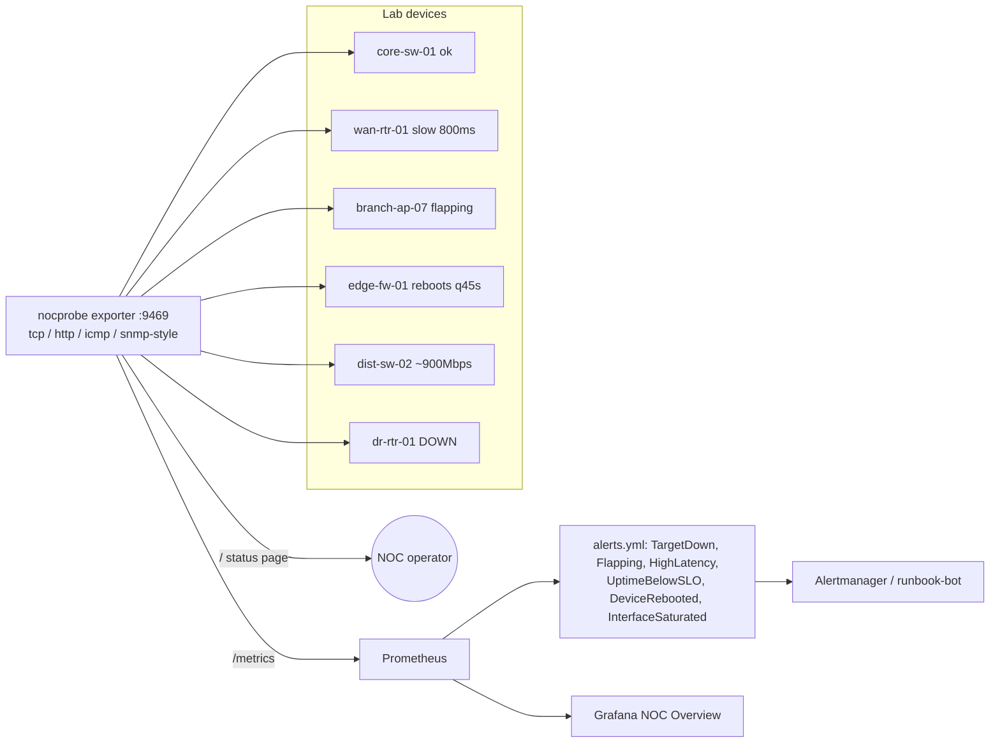

# noc-probe-dashboard: NOC monitoring with probe exporters, Prometheus alerts and Grafana

> **Lab project.** The "network devices" are simulated by `lab/devices.py` (one HTTP listener per device). The SNMP poll is **SNMP-style**: it reads IF-MIB/SYSTEM-MIB-shaped values (sysUpTime, ifInOctets, ifSpeed) as JSON over HTTP, because my lab machine has no snmpd. The OIDs to use with a real `pysnmp` GET are noted in `nocprobe/probes.py`.

## Problem
A NOC needs one place that answers three questions: what's down right now, what's degrading (latency, flapping, saturation), and what our uptime is against the SLO. It also needs alerts that don't page on a single dropped probe. This project is a small Prometheus exporter that runs TCP, HTTP, ICMP and SNMP-style probes, plus alert rules **unit-tested with promtool**, a Grafana dashboard, and a live status page.

## Architecture


Metrics: `noc_probe_up`, `noc_probe_latency_seconds`, `noc_probe_uptime_ratio` (rolling window), `noc_probes_total{result}`, `noc_device_uptime_seconds`, `noc_if_in_octets`, `noc_if_speed_bits`. A recording rule `noc:if_in_bps:rate1m` gives interface throughput.

## Run
```bash
pip install -r requirements.txt && pytest -q
promtool check rules prometheus/alerts.yml && promtool test rules prometheus/alerts_test.yml
DUR=150 lab/run_lab.sh             # devices + exporter + real Prometheus, prints firing alerts
docker compose up --build          # + Grafana on :3000 (dashboard provisioned)
```

## Results (actual runs, 2026-10-11, Prometheus 2.54.1)
- `pytest`: **5 passed**. `promtool test rules`: **SUCCESS** (TargetDown honours `for: 30s`, flapping counts 4 changes, reboot detection via `resets()`, saturation at 960 Mbps on a 1G link).
- Live lab, 150 s (`results/lab_run.log`, `metrics_snapshot.txt`, `alerts.json`, `status_page.html`):

| Alert | Target | State | Expected? |
|---|---|---|---|
| TargetDown | dr-rtr-01 | firing | yes (nothing listening) |
| TargetFlapping + UptimeBelowSLO | branch-ap-07 | firing (uptime 57.7%) | yes |
| TargetDown | branch-ap-07 | pending | yes (`for: 30s` stops a page during the flap's down half) |
| HighLatency | wan-rtr-01 | firing (801 ms) | yes |
| DeviceRebooted | edge-fw-01 | firing | yes |
| InterfaceSaturated | dist-sw-02 | **pending** at 872.7 Mbps (87%) | yes, but hadn't passed `for: 30s` after the 1-minute rate warm-up when the run ended |
| (none) | core-sw-01 | healthy, 100% | yes |

- **ICMP** shows `ping_unavailable`. My lab machine has no `ping` binary and raw sockets need root, so the probe reports the error instead of faking an "up". The alert rules exclude `type="icmp"` for that reason.
- **A bug the lab caught:** my first simulator added 120 MB per poll, which is only about 192 Mbps (log in `results/lab_run_v1_sim_bug.log`), so saturation never triggered. I fixed the math to about 960 Mbps.

**Not run:** Grafana and Docker Compose (no Docker). The dashboard JSON is provisioned but I never saw it rendered.

## Limitations
- SNMP is simulated. Real SNMP needs `pysnmp` or `snmp_exporter`, Counter64 wrap handling, and community/v3 auth.
- The rolling uptime window lives in exporter memory and resets on restart. For SLO reporting use `avg_over_time(noc_probe_up[30d])` in Prometheus.
- Probes run sequentially. Hundreds of targets would need async probes or the standard `blackbox_exporter`.
- No multi-site deduplication or alert inhibition (e.g. suppress all branch alerts when the WAN router is down).

## Sources
- Prometheus alerting rules and `promtool test rules`: https://prometheus.io/docs/prometheus/latest/configuration/unit_testing_rules/
- blackbox_exporter (production alternative): https://github.com/prometheus/blackbox_exporter
- IF-MIB (RFC 2863): https://www.rfc-editor.org/rfc/rfc2863
- Google SRE book, Monitoring Distributed Systems: https://sre.google/sre-book/monitoring-distributed-systems/
